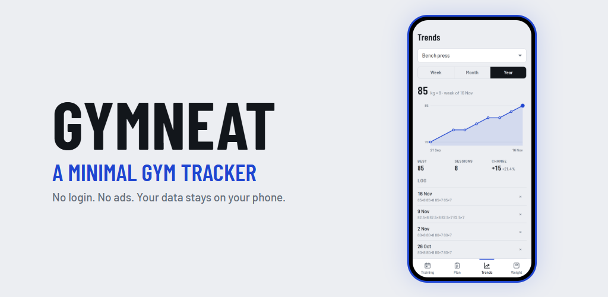
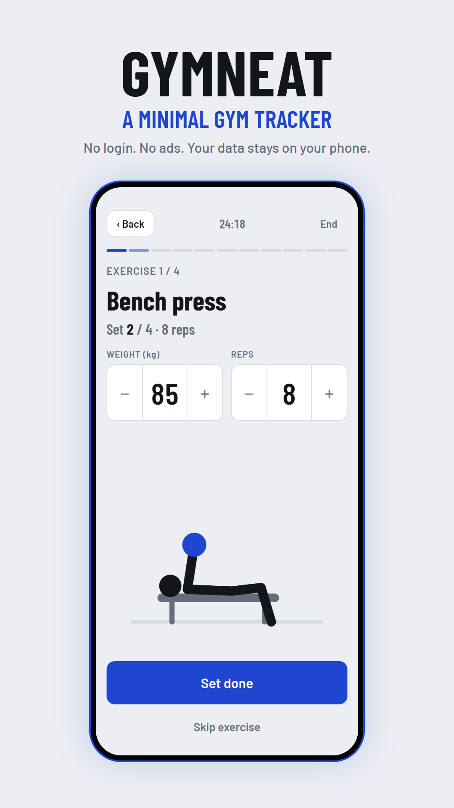
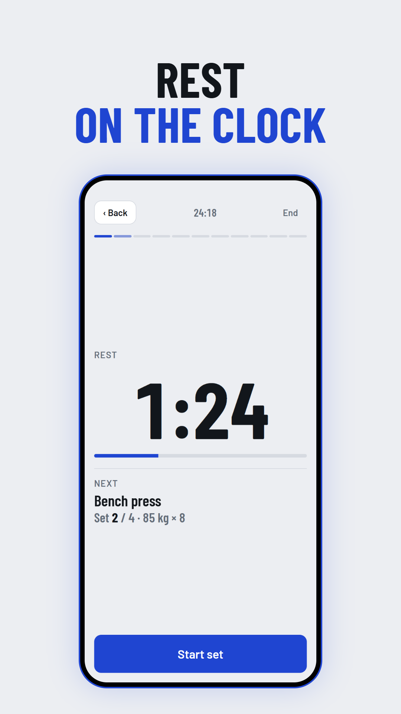
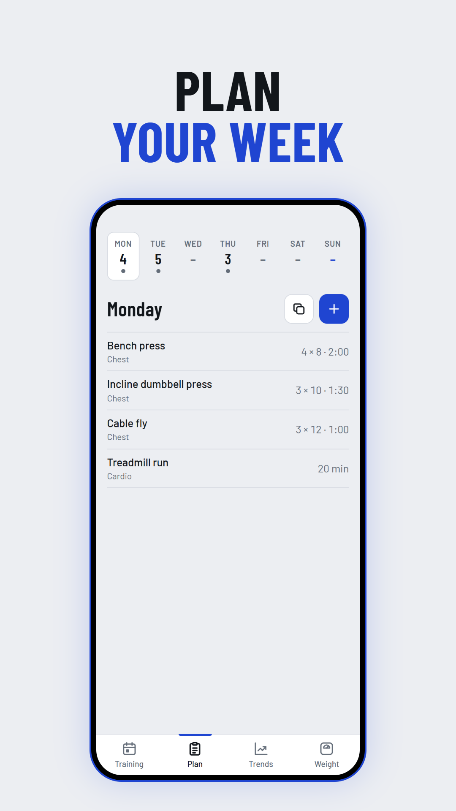
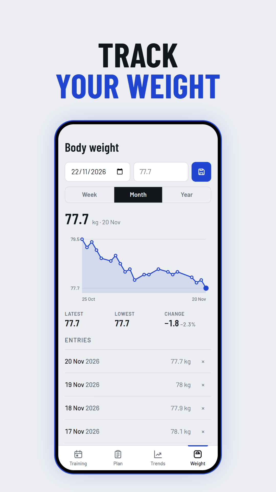

<!-- Images come from store/make_listing.py; each has a -dark twin shown to readers using GitHub in dark mode. -->
<p align="center">
  <picture><source media="(prefers-color-scheme: dark)" srcset="store/feature-graphic-dark.png"></picture>
</p>

<p align="center">
  <picture><source media="(prefers-color-scheme: dark)" srcset="store/1-main-dark.png"></picture>
  <picture><source media="(prefers-color-scheme: dark)" srcset="store/2-rest-dark.png"></picture>
  <picture><source media="(prefers-color-scheme: dark)" srcset="store/3-plan-dark.png"></picture>
  <picture><source media="(prefers-color-scheme: dark)" srcset="store/6-weight-dark.png"></picture>
</p>

A minimal gym tracker for Android and the web: plan your week, run sessions set by set with a rest timer, and track your progress.

No log-in, no ads, no server, no Internet. Data stays only on your phone.

## Features

- Weekly plan built from 99 exercises, plus your own
- Sessions with pre-filled weights, a rest timer, and a moving figure showing each exercise
- Android: a notification when the rest ends
- Trends per exercise and for body weight (week, month, year)
- Optional backup and restore in .JSON format

## How it's built

The app is plain HTML, CSS and JavaScript modules (no bundler, no framework) at the project root. The same code runs in a browser and, packed with [Capacitor](https://capacitorjs.com) 8, as an Android app. Android-only features (back button, rest notifications, vibration, file sharing) are in `js/native.js`; in a browser they do nothing. Details in [docs/tech.md](docs/tech.md).

## Requirements

- Node 22+. `npm install` installs Capacitor and its plugins; nothing to install globally.
- Android Studio (includes the Android SDK), for the Android app. Its bundled Java 25 runs Gradle; on the first build Gradle downloads the Java 21 the Capacitor plugins need.

## Run on the web

- **On your computer:** `npm start` (or `python3 -m http.server 8000`), then open http://localhost:8000. Opening `index.html` directly shows a blank page, because browsers only load JavaScript modules over HTTP.
- **On GitHub Pages:** in the repository, go to **Settings → Pages**, deploy from `main`, root. The app is then at `https://<your-username>.github.io/<repo-name>/`.

### Install it on a phone from the web

Open that address in Chrome on Android, then **⋮ → Add to home screen → Install** (older versions: **⋮ → Install app**). It gets the app's icon and opens full screen, without the browser's address bar. *Create shortcut*, in the same dialog, only makes a bookmark that opens in a browser tab.

### Limits of the web version

The same code runs in both places, but these need the Android app:

- **No rest notification.** Leave the app during a rest and nothing tells you it ended: without a server, a browser cannot schedule a notification for later. The rest still beeps while the app is on screen.
- **It needs a connection to start.** The files are fetched each time it opens; after that it sends nothing. The Android app carries them inside it and never needs a connection at all.
- **Backups are copy-only.** *Export* writes a file through Android's share menu; on the web there is only *Copy JSON*, which you paste somewhere yourself.
- **The data is easier to lose.** Clearing the browser's site data deletes it, and a phone short of space may evict it on its own. App data lasts until you uninstall the app or clear its storage, and Android can include it in your Google backup.

## Run on Android

```sh
npm install      # first time only
npm run sync     # copy the app into www/ and update the Android project
npm run open     # open in Android Studio, then Run on a phone or emulator
```

### Install on a phone without Android Studio

Build a debug APK (a test build, signed with your computer's debug key):

1. Copy your latest changes into the Android project:

   ```powershell
   npm run sync
   ```

2. Tell this terminal where Java and the Android SDK are (until you close it):

   ```powershell
   $env:JAVA_HOME = "C:\Program Files\Android\Android Studio\jbr"
   $env:ANDROID_HOME = "$env:LOCALAPPDATA\Android\Sdk"
   ```

3. Build the APK and wait for **BUILD SUCCESSFUL**:

   ```powershell
   android\gradlew.bat -p android assembleDebug
   ```

4. Copy `android\app\build\outputs\apk\debug\app-debug.apk` to the phone (USB, Drive or email) and open it. The first time, allow installing apps from that source.

A new APK built on the same computer installs over the old one and keeps your data.

Run `npm run sync` after every change to the app. `www/` and `android/app/src/main/assets/public/` are generated copies: never edit them.

## Your data

All data is saved on the device as soon as you change it: inside the app on Android, in the browser on the web. Uninstalling the app, clearing its storage or clearing the browser's site data deletes it (iPhone Safari also clears it after 7 days unused, unless the app is on the home screen). **Back up regularly** under *Data* at the bottom of Trends: *Export* (Android, opens the share menu) or *Copy JSON*. *Import* restores a backup. What is stored, and the file format: [docs/data.md](docs/data.md).

## Privacy

The full privacy policy is in [PRIVACY.md](PRIVACY.md), and in the app under *Privacy* at the bottom of Trends. In short:

- The app makes **no network connections**: no server, no account, no analytics Fonts and every other file ship with it.
- Data leaves the device only when **you** export it, copy it, or share the backup file.
- Android may include the app's data in **your own Google backup**, if backup is on in your phone's settings, so it can be restored on a new phone.
- The web version is downloaded from wherever it's hosted (for example GitHub Pages); after that it sends nothing.

## Project structure

See [docs/project-structure.md](docs/project-structure.md). More docs: [docs/data.md](docs/data.md) (what is stored, file format) and [docs/tech.md](docs/tech.md) (technologies).

## Test

```sh
npm test         # Node 22+
```

## License

Gymneat © 2026 serrant

Gymneat is free software under the [GNU General Public License, version 3](LICENSE.txt) (GPL-3.0-only). You may use, share and change it; versions you share must be released under the same terms, with their source code. It comes with no warranty.

The open-source parts inside the app (Capacitor, AndroidX, Kotlin and the Barlow fonts) are listed with their licences in [THIRD-PARTY-NOTICES.txt](THIRD-PARTY-NOTICES.txt) and [fonts/OFL.txt](fonts/OFL.txt). In the app, *GPL-3.0* under *Data* in Trends shows all of these texts.
